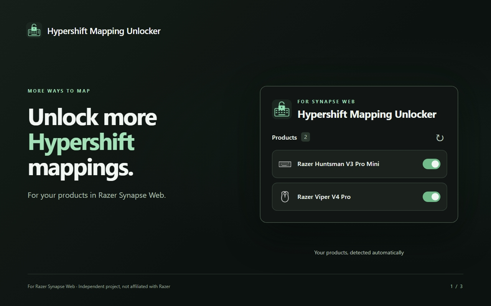

# Razer Synapse Web Hypershift Unlocker

  

A Chrome extension that unlocks restricted Hypershift mappings in
[Razer Synapse Web](https://synapse.razer.com/dashboard).

- Automatically detects Razer products, including keyboards and mice.
- Shows product names and icons from Synapse's sidebar.
- Remembers an on/off toggle for each product.
- Lets you reload immediately after a change or apply it later.
- Opens the Synapse dashboard when clicked from another website.

Products without matching mapping restrictions are left unchanged. Available
mappings still depend on the product and its firmware.

## Install

1. Download the extension ZIP from [Releases](https://github.com/Almo7aya/razer-synapse-web-hypershift-unlocker/releases)
   and extract it. Until a release is available, [download the source](https://github.com/Almo7aya/razer-synapse-web-hypershift-unlocker/archive/refs/heads/main.zip)
   and use its `extension` folder.
2. Open `chrome://extensions` and enable **Developer mode**.
3. Click **Load unpacked** and select the extracted extension folder.
4. Reload Synapse Web.

## Use

Open the extension from the toolbar while using Synapse Web. Products are
enabled by default. Change a toggle, then choose **Reload now** or **Later**.
Your choices take effect when Synapse reloads.

## Privacy

Product preferences stay in local browser storage. The extension has no
analytics or external backend, and site access is limited to Synapse Web.
See the [privacy policy](PRIVACY.md).

## Contributing

[Bug reports and product compatibility reports](https://github.com/Almo7aya/razer-synapse-web-hypershift-unlocker/issues/new/choose)
are welcome. See [CONTRIBUTING.md](CONTRIBUTING.md) for development instructions.

For Synapse Web only; does not modify desktop Synapse or device firmware.
Independent project, not affiliated with or endorsed by Razer.

[MIT licensed](LICENSE).
